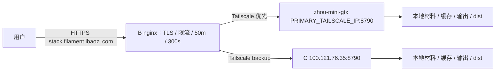

# Lumina 主备部署包（任务 A）

本目录仅提供脚本和配置，未部署服务器。以 `TASK-A.md` 文末「追加约束 2」为准：主力是家里 Linux `zhou-mini-gtx`，备用是 C。两台只用 CPU，均由同一个 Python 后端托管 Lumina 前端 dist，前端无需修改。



B 的 Tailscale IP 为 `100.70.57.112`。后端绑定 `0.0.0.0`；入口不是公网暴露服务。主备两台均只在 `tailscale0` 上允许 B 访问 8790，必须检查已有防火墙宽泛放行规则。TLS、nginx 和按 IP 限流只在 B 配置，后端不依赖 nginx、certbot 或 docker。

## 文件

| 文件 | 用途 |
| --- | --- |
| `build.sh` | box 离线前端构建及源码打包，输出 tar.gz、SHA256、BUILD-INFO |
| `install.sh`、`common.sh`、`deploy_support.py` | 双机通用安装、env 预检、CPU 依赖处理、资源 drop-in、健康检查、自动恢复；Python 助手也采样 RSS |
| `rollback.sh` | 回到 previous，失败恢复回滚前版本 |
| `lumina.service` | 统一服务入口和写权限加固，资源额度由 drop-in 注入 |
| `env.primary.example`、`env.c.example` | 分机配置；前者资源保留待填占位，后者为 C 的限制 |
| `nginx-b-stack.conf` | B 子域完整替换配置：主力 upstream + C backup |
| `nginx-b-limit-req-zone.conf` | B 的 http 级按 IP 限流 zone |
| `cleanup-output.sh`、`lumina-cleanup.service`、`lumina-cleanup.timer` | 每小时清理超过保留期的输出和预览工件 |
| `ufw.sh` | 两台共用，默认打印，`--apply` 仅添加 B 来源规则 |
| `smoke.sh`、`smoke.py` | 30 秒内完成真实预览/3MF 冒烟 |
| `smoke-box.sh` | box 隔离副本启动，模拟 C 限额，采样后端进程树峰值 RSS |
| `tests/test_deploy.py` | 无网络、无系统安装操作的离线测试 |

## 先核对环境

源码参考 commit 为 `b89af08226a88c9c9b3e2934ea1838c449923858`。源码入口为 `python api_server.py`。C 为 Ubuntu 24.04.5 / Python 3.12.3 / 2 vCPU / 总内存约 3.6G / swap 1.9G / 剩余盘 31G。主力的 CPU、内存、swap 额度及 Tailscale IP 待运维补充；禁止直接把占位配置用于生产。

安装器以 root 执行，先安装 `python3.12-venv python3-pip`，然后建立每版独立 venv；另装 `curl libgl1 libglib2.0-0`。保留上游 `opencv-python`，由系统库解决无桌面服务器的 libGL 依赖。本方案不替换成 headless，故不需要篡改上游 requirements 或伪造包名约束。

普通 pip 安装使用 `--isolated`，忽略机器上的 pip 配置，禁用 pip 版本检查。首选腾讯内网 `http://mirrors.tencentyun.com/pypi/simple --trusted-host mirrors.tencentyun.com`，失败自动换 `https://mirrors.cloud.tencent.com/pypi/simple --trusted-host mirrors.cloud.tencent.com`。当前 requirements 无 torch。若后续出现 torch/torchvision/torchaudio，安装器先拆分到临时文件，从官方 `https://download.pytorch.org/whl/cpu` 安装并将实际版本作为普通安装的临时约束；不修改上游文件。明确 CUDA 包、CUDA torch 版本、URL 或递归 requirements 会拒绝并要求核对；先用 pip dry-run report 检查传递依赖再实际安装，安装后再次检查 CUDA 包及 `+cpu` 版本。CPU wheel 源在后端网络不可达时安装失败，必须由运维先准备可达的 CPU wheel 供应，不能退回 CUDA 包。

## box 构建

不执行安装依赖命令，不写参考源码。`build.sh` 读取干净的 Git HEAD 快照，在临时副本复制已有 node_modules 后执行 `tsc -b && vite build`；这样 tsc 的构建缓存、Vite 临时文件和 dist 均写入副本。默认参考源码目录没有 node_modules 时，可复用已准备好的 `/workspace/lumina-upstream/frontend/node_modules`：

```bash
bash deploy/lumina/build.sh --help
bash deploy/lumina/build.sh \
  --frontend-deps /workspace/lumina-upstream/frontend/node_modules \
  /workspace/dev/filament-lumina /tmp/lumina-A-build
cd /tmp/lumina-A-build
sha256sum -c lumina-*.tar.gz.sha256
```

包内含后端、运行资产、LUT、前端 dist、requirements、LICENSE、BUILD-INFO。排除 Git、依赖、前端 src、测试、Electron、日志、输出、材料快照和本地 env；不会夹带未跟踪文件。输出目录须在源码之外。向两台机器分别传送同一个 tar.gz、对应 `.sha256` 及本目录部署工具；文件传输和服务器执行由运维完成。不要传 `materials-seed/` 的工作目录；E 块交付的 seed 是独立只读制品。

## 首次部署两台后端

1. 运维先确认两台系统和 Python 3.12 可用、Tailscale 连通、UFW 安全策略及 SSH 管理通道。
2. 先部署 C，验证可作为备用；再部署主力，最后改 B。部署命令的文件名用实际生成的包名替换。
3. C 可直接使用 C 模板；主力复制模板到运维目录并填写 `LUMINA_MEMORY_MAX`、`LUMINA_MEMORY_SWAP_MAX`、`LUMINA_CPU_QUOTA`。首次创建主力 env 时，安装器按 `max(1,nproc-2)` 填并发并打印建议值，仍需按内存实测调整。主力规格未定时安装会拒绝占位额度。

```bash
# 在 C：先评审输出，再实际执行（外部执行者操作）
sudo bash /path/to/lumina/install.sh --dry-run --profile c /path/to/lumina-release.tar.gz
sudo bash /path/to/lumina/install.sh --profile c /path/to/lumina-release.tar.gz

# 在主力：先填写自有文件，不修改交付模板
cp /path/to/lumina/env.primary.example /path/to/primary.env
# 编辑 primary.env 的资源额度，均用简单 KEY=VALUE，无引号、空格、变量展开
sudo bash /path/to/lumina/install.sh --dry-run --profile primary \
  --env-template /path/to/primary.env /path/to/lumina-release.tar.gz
sudo bash /path/to/lumina/install.sh --profile primary \
  --env-template /path/to/primary.env /path/to/lumina-release.tar.gz
```

安装器创建系统用户 `lumina`，发布代码由 root 持有。env 位于 `/etc/lumina/lumina.env`，属 root:lumina、0640；已有文件完全保留。env 必须只使用示例中的简单赋值形式；安装器解析而不执行配置文本，也不打印值。相同机器的安装/回滚用 flock 互斥。

材料 seed 如需启用，运维将 E 块交付的 zip 放到 lumina 可读的本地绝对路径（例如 `/opt/lumina/shared/seed/materials.zip`），在 env 填 `LUMINA_MATERIALS_SEED_PATH`。它只在空耗材库启动时安装，不用于覆盖现有库。此任务不创建或改动 seed 制品，也不启用在线 Registry。

两台分别运行 `bash ufw.sh` 查看建议。确认 SSH 实际端口和带外管理后，由运维设置默认拒绝入站、保留管理入口，检查并移除其他对 8790 的宽泛放行，再用 `sudo bash ufw.sh --apply` 加规则。该脚本不会启用 UFW、不会修改 SSH 或默认策略：

```bash
ufw allow in on tailscale0 from 100.70.57.112 to any port 8790 proto tcp
```

UFW 未启用、已有宽泛规则、或 Tailscale 自身的 netfilter/ACL 链先行放行都会影响实际隔离。运维应从 B、另一个 Tailscale 节点和普通网卡分别验证，确保只有 B 可达；必要时配合 Tailscale ACL 收紧来源。

## B 的 nginx

先备份原 302 server 块所在文件到 nginx include 目录外。核对真实 TLS 证书路径：仓库旧示例只有 `/path/to/fullchain.pem`、`/path/to/privkey.pem`，本包沿用占位写法，未假定 B 的证书目录。

将 `nginx-b-limit-req-zone.conf` 放入 B 的 `/etc/nginx/conf.d/lumina-limit-req-zone.conf`，确保在 `http {}` 层 include。把 `nginx-b-stack.conf` 中主力 IP 占位替换为真实 Tailscale IPv4、核对证书后，用其中两个 server 块**替换**旧子域块，并将 upstream 放入 http 层；不要与旧 302 块并存。其他站点不改。

执行 `nginx -t` 成功后才 `systemctl reload nginx`。HTTP 跳 HTTPS，443 整站反代主备 upstream；50m 上传、300s 读写超时、每 IP 普通 10r/s、计算接口 2r/m（burst=2）均在 B 生效。没有前置 CDN 的假设下使用 `$binary_remote_addr`；如 B 前另有代理，应由运维核对可信 real_ip 配置，不能信任任意来访 X-Forwarded-For。

`proxy_next_upstream error timeout http_502 http_503` 与 `proxy_next_upstream_tries 2` 允许在连接错误等情况尝试备用。**没有**设置 `non_idempotent`：POST 已发往主力后不会自动重放，即使发生超时/502/503；尚未发出的连接失败可尝试备机。不要为了透明重试而开启它，否则生成类 POST 可能重复执行；用户看到失败后可重新生成。主备各自本地会话、任务和文件缓存，单靠 nginx 无法迁移任务。

前端 API 使用 `X-Lumina-Async: 1` 和 `/api/jobs/{id}` 长轮询。源码未注册 SSE 或 WebSocket 路由，故使用 HTTP/1.1 并清空 Connection 支持 keepalive；jobs 路径关闭 proxy buffering 和 proxy cache。无须添加 WebSocket Upgrade 或虚构流式端点。

B 回滚：恢复备份的原 302 配置，移除新增 upstream/新 server 和 zone 文件，`nginx -t` 成功后 `systemctl reload nginx`。

## 发布、原子切换与回滚

每次运行 `install.sh` 新建 `/opt/lumina/releases/<东京时间戳>/`、独立安装 venv，不覆盖旧版或持久数据。用 `ln -sfn <release> current.next` 创建软链接，再 `mv -Tf current.next current` 在同一文件系统原子 rename；直接 `ln -sfn <release> current` 存在短暂删除窗口，本包用该补充步骤保证原子可见。

切换后安装器 `daemon-reload`、restart，再 curl 本机 `/api/health`，同时检查 `status=ok` 和 `worker_pool.healthy=true`。失败恢复旧 current 和旧服务/drop-in，重启并检查旧版；首次部署无旧版则停止失败服务。失败命令保持非零退出。只有成功健康的发布才更新 `/opt/lumina/previous`。失败 release 保留用于排查。

升级顺序：先 C，直接对本机新包运行同样的 `--profile c` 安装命令并验健康；再主力 `--profile primary` 安装；最后验证子域。已有 env 不覆盖。调整资源额度时先编辑各机 env，再重新运行安装器生成 `/etc/systemd/system/lumina.service.d/10-resources.conf`；单独 restart 不会重生成 drop-in。

```bash
# 两台后端分别执行；回滚不操作 B，也不更改共享材料/设置
sudo bash /path/to/lumina/rollback.sh --dry-run
sudo bash /path/to/lumina/rollback.sh
readlink -f /opt/lumina/current
systemctl status lumina.service
```

回滚切回 previous，重启、健康检查；目标失败则自动恢复回滚前版本。成功后 previous 指向刚才版本，可再次切回。保留至少 current、previous 两版；不要删除这些软链指向的目录。回滚只恢复代码和 venv，不逆转材料、用户设置或缓存格式变更；升级前独立备份 `/opt/lumina/shared` 和 `/var/lib/lumina/materials`，跨格式升级需人工核对兼容性。

主备切换演练：从 B 分别 curl 两台 `/api/health`，验证子域可上传生成；在维护窗口停止主力 lumina（或关机），等待被动失败检测，重新打开子域并**重新上传生成**，确认 C 日志记录请求；重新启动主力，等待 30 秒故障窗口后重复新会话，确认恢复主力。首次失败请求不保证成功。已有预览、文件 URL、轮询任务可能 404/409；两台的缓存都在各自本地，主力关机后 C 无法获取正在生成的任务或已有预览缓存，用户需要重新生成。主力恢复后，C 上仍在使用的会话同样可能需要重建。

## 运行时写盘和加固

| 上游实际位置/机制 | 本包映射 |
| --- | --- |
| `config.OUTPUT_DIR=<repo>/output`，含 `temp/`、`models/`、上传、预览、3MF、GLB、项目资源 | 每个 release 的 `output` 软链到 `/var/lib/lumina/output`；上游没有可用的 OUTPUT_DIR env |
| `materials/`（配置导入即 mkdir） | `LUMINA_MATERIALS_DIR=/var/lib/lumina/materials`，附兼容软链 |
| 求解缓存 `_solver_cache` | `LUMINA_RUNTIME_CACHE_DIR=/var/lib/lumina/cache`，实际写其 `_solver_cache/` 子目录；**不是**预览缓存路径 |
| 预览缓存工件 `.npy`/manifest 等 | `TEMP_DIR=<output>/temp`，容量保护 `LUMINA_PREVIEW_CACHE_MAX_BYTES` 是单次估算字节数，不是全目录硬上限 |
| `logs/` / JSONL logger | `LUMINA_LOG_PATH=/var/log/lumina/lumina.jsonl` 是文件路径，并提供 logs 软链 |
| `user_settings.json` | `LUMINA_SETTINGS_PATH=/opt/lumina/shared/user_settings.json`，上游要求绝对文件路径 |
| `lut-preset/Custom`、`Cloud`、`_sync/luts` | 链接到 `/opt/lumina/shared/lut-preset/` 对应目录，初次拷贝内置 Custom、不覆盖已有文件 |
| 旧版提色和修色在相对 `assets/` 创建 `temp_5c_ext_page_*.json`、`temp_8c_page_*.json`、`temp_8c_full_page_*.json` | 没有对应 env；assets 顶层目录归 lumina，systemd 单独开放 `/opt/lumina/current/assets`；内置资产文件仍为 root 所有，临时页随 release 保留、不在定时清理范围 |
| Workshop 包、反馈工件 | `LUMINA_WORKSHOP_DATA_DIR` → shared/workshop；`LUMINA_FEEDBACK_DUMP_DIR` → output/feedback |
| 用户 3MF 模板等 `_desktop_user_data_dir()` | `XDG_DATA_HOME=/opt/lumina/shared/xdg` 下的 `lumina-studio/`；项目临时模板仍在 output/temp |
| Numba 和第三方库缓存 | `NUMBA_CACHE_DIR`、`XDG_CACHE_HOME` 指向 `/var/lib/lumina/cache` 子目录；Python 禁写 pyc |

主单元 `ProtectSystem=strict`，开放 `/var/lib/lumina`、`/var/log/lumina`、`/opt/lumina/shared` 及上表说明的 release assets 目录，使用 lumina 用户、PrivateTmp/PrivateDevices/NoNewPrivileges，Python/前端代码和 venv 只读。上游 local-origin guard 原样保留：公开页面的部分本机设置、切片器启动、材料管理接口可能 403；不启用已退役的公开旁路变量。

C 的 `MAX_WORKERS=1`、MemoryMax=2.5G、MemorySwapMax=512M、CPUQuota=150%，总额度含所有 worker，Nice=5。预览和 3MF 是内存大户，并发大于 1 易 OOM 影响其他服务。主力按实际规格设置，并发建议 nproc-2，最少 1。两份 env 的单次预览估算保护默认 256 MiB，可随各机额度评估。MemoryMax 管的是整个 cgroup，不保证一张任意尺寸图片都能完成。

## 输出保留与空间

每小时执行清理，默认仅删除 `/var/lib/lumina/output` 和其 `temp` 内 mtime 超过 24h 的普通文件，不跟随软链接、不跨文件系统、不删除目录。空路径、根目录、缺失目录、作为链接的清理根会被拒绝；先验证所有根再删除。默认不清除材料、求解缓存或日志。

要改保留小时数，在本机 `/etc/lumina/cleanup.env` 写 `LUMINA_CLEANUP_HOURS=48`（正整数），下次 timer 读取生效。可手工运行 `sudo -u lumina bash /opt/lumina/shared/deploy/cleanup-output.sh --hours 24`。清理按 mtime，无运行任务锁；不要将 TTL 设得短于任务/会话实际寿命，旧会话文件过期后用户须重新生成。

日志文件仍需运维接入现有轮转（如保留最近若干天、copytruncate 或在轮转后重启打开文件）；没有配置轮转时会持续增长。监控输出、求解缓存、日志及 releases 的占用；31G 盘不适合无限保留 release/缓存。不要手工清空 materials 或删除 current/previous 指向版本。

## 冒烟和离线自测

```bash
# box：对已启动的后端；有网络动作，但只请求运维指定的 Lumina 服务
bash deploy/lumina/smoke.sh http://127.0.0.1:18101
# box：实际启动隔离副本，默认源码无 dist 时指定已有 dist
bash deploy/lumina/smoke-box.sh \
  --source /workspace/dev/filament-lumina --dist /workspace/lumina-upstream/frontend/dist
# 离线包测试，不安装依赖、不访问外网
PYTHONDONTWRITEBYTECODE=1 pytest -q -o cache_dir=/tmp/lumina-a-pytest deploy/lumina/tests
for file in deploy/lumina/*.sh; do bash -n "$file"; done
```

核实的接口为 `GET /api/health`、`GET /api/lut/list`、`POST /api/convert/preview`（multipart `image`、`source_kind=legacy_single`、返回列表中的 `lut_name`、`color_mode=4-Color (RYBW)`、`modeling_mode=high-fidelity`）、`POST /api/convert/export-materials`（必要时使用 API 实际返回的候选预设）、`POST /api/convert/generate`（JSON `{session_id,params}`）以及响应给出的 `GET /api/files/{file_id}`。经典模式是 LUT 来源选择，与 high-fidelity 建模策略是两个维度。优先选路径 `lut-preset/bambulab/bambulab_pla_basic_rybw.npy`；只有不存在时才选 Custom 下 Bambulab RYBW。绝不把本地 LUT 路径当成参数传给生成接口。

冒烟生成固定 16×16 PNG、10mm 小模型；上传和预览是同一个 API 调用，之后下载预览、生成下载 3MF，检查 ZIP CRC、`3D/3dmodel.model` 和 XML model 根。每步输出耗时，全程超过 30 秒非零退出；首次 JIT 也计时，不为了通过而预热或扩大阈值。`smoke-box.sh` 的服务启动等待另计，数据都放 `/workspace/dev/lumina-run/A/run-*`；结束停止所启动的进程树，日志和峰值留存。

资源限制先实际探测 `systemd-run --user --scope -p MemoryMax=2.5G`，不可用回退 prlimit --as，再回退 ulimit -v，并打印实际使用方式。后两种限制虚拟地址空间，与 systemd cgroup 总内存不等价；可能更早遇到映射/导入错误，失败必须如实记录。每 0.5 秒采样后端进程树 RSS 之和并报告峰值；共享页可能重复计数且瞬时峰值可能漏采，不等于 cgroup memory.peak。

sandbox 不能监听端口时，可将发布包解到 `/tmp` 隔离副本，设置与 smoke-box 相同的可写目录 env，再用 `smoke.sh --in-process --source /tmp/隔离副本`；FastAPI TestClient 不监听端口。禁止直接对只读参考源码 import app，因为 config 导入即创建 output/materials 等目录。真正的主备、防火墙、nginx、资源和公网冒烟须由外部执行者跑，本包离线测试不能代替。

## 故障排查

- 启动失败：查 `journalctl -u lumina -n 100 --no-pager`、`/var/log/lumina/lumina.jsonl`、`systemctl cat lumina`；核对 current、.venv、frontend/dist 和 root:lumina env 权限。403 先核对是否上游本机接口限制，不添加旁路。
- 502/504：从 B 检查到两台 Tailscale 地址的 health、UFW 默认策略和 ACL；检查 B 占位 IP/证书已替换，worker pool 真的 healthy。jobs 404 和生成 409 可能是切机或缓存过期，重新上传。
- 429：B 的计算限流按 IP 聚合，同出口多个用户也共享额度；等待恢复再生成，按运维容量评估策略。
- OOM/137/worker broken：检查 `systemctl show lumina -p MemoryCurrent -p MemoryPeak -p MemoryMax`、内核 OOM 日志，降低并发和图片尺寸；不要直接扩大 C 的内存上限挤占其他服务。
- pip 失败：检查两个腾讯镜像、CPU wheel 可达性、Python 3.12/架构/glibc wheel 支持；禁止静默换未批准依赖版本。`libGL.so` 缺失检查 apt 的 libgl1。
- 磁盘满或只读错误：核对 output 软链、env 绝对路径、ReadWritePaths 和 lumina 目录所有权；检查 timer、日志轮转和旧 releases，不能让整个 release 可写来绕过加固。

## AGPL 与对应源码

Lumina 为 AGPL-3.0-only。公开网络服务应向用户提供运行版本的对应源码获取方式，fork 地址为 <https://github.com/a523959108-rgb/filament-lumina>。正式对外前，运维须确认该 fork 提供 BUILD-INFO 对应 commit、完整前后端源代码和实际修改（包括部署修改），并在公开服务可发现位置提供源码链接。运行 tar.gz 为精简制品，排除 frontend/src，不能单独替代完整对应源码；保留 LICENSE 和构建信息。此任务不改前端，因此公开源码入口是否可发现须上线前核对。
