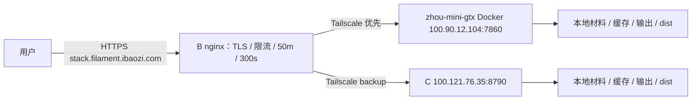

# Lumina 主备部署包（任务 A）

本目录仅提供脚本和配置，未部署服务器。本轮落实 `TASK-A.md`「追加约束 3、4」及 TASK-A2：主力 `zhou-mini-gtx` 默认 Docker，备用 C 使用 venv + systemd。两台只用 CPU，由同一 commit 的 Python 后端托管前端 dist。



B 的 Tailscale IP 为 `100.70.57.112`。主力只发布 `100.90.12.104:7860` → 容器 `0.0.0.0:8790`；C 绑定 `0.0.0.0:8790`。主力在 tailscale0 放行来自 B 的 7860，C 放行 8790；Docker 转发链还需核对下文。TLS、nginx、按 IP 限流只在 B；C 不依赖 Docker、nginx、certbot。

## 文件

| 文件 | 用途 |
| --- | --- |
| `build.sh` | box 离线前端构建及源码打包，输出 tar.gz、SHA256、BUILD-INFO、完整40位 `LUMINA_COMMIT` |
| `check-commit.sh` | Docker 构建与 C 安装共用的 commit 拒绝校验 |
| `docker/Dockerfile`、`docker/compose.yaml` | 主力 CPU 镜像、非 root、healthcheck、6 CPU / 8G / 4 workers、持久卷 |
| `docker/.dockerignore`、`docker/build-image.sh` | 从已验发布包准备临时构建上下文并构建镜像；不操作已有容器 |
| `install.sh`、`common.sh`、`deploy_support.py` | 双机通用安装、env 预检、CPU 依赖处理、资源 drop-in、健康检查、自动恢复；Python 助手也采样 RSS |
| `rollback.sh` | 回到 previous，失败恢复回滚前版本 |
| `lumina.service` | 统一服务入口和写权限加固，资源额度由 drop-in 注入 |
| `env.primary.example`、`env.c.example` | 前者是主力 systemd 备选，资源须填；后者为 C 的限制 |
| `nginx-b-stack.conf` | B 子域完整替换配置：主力 upstream + C backup |
| `nginx-b-limit-req-zone.conf` | B 的 http 级按 IP 限流 zone |
| `cleanup-output.sh`、`lumina-cleanup.service`、`lumina-cleanup.timer` | 每小时清理超过保留期的输出和预览工件 |
| `ufw.sh` | 两台共用，默认打印，`--apply` 仅添加 B 来源规则 |
| `smoke.sh`、`smoke.py` | 30 秒内完成真实预览/3MF 冒烟 |
| `smoke-box.sh` | box 隔离副本启动，模拟 C 限额，采样后端进程树峰值 RSS |
| `tests/test_deploy.py` | 无网络、无系统安装操作的离线测试 |

## 先核对环境

源码参考 commit 为 `b89af08226a88c9c9b3e2934ea1838c449923858`，以下核查均以此版本为准；入口 `python api_server.py`。主力为 Ubuntu 24.04.5 / Ryzen 7 8845HS（8核16线程）/ 20G（可用约16G），已有 Docker 和 HA 等家庭服务。C 为 Ubuntu 24.04.5 / Python 3.12.3 / 2 vCPU / 3.6G / swap 1.9G / 剩余盘31G。

安装器以 root 执行，先安装 `python3.12-venv python3-pip`，然后建立每版独立 venv；另装 `curl libgl1 libglib2.0-0`。保留上游 `opencv-python`，由系统库解决无桌面服务器的 libGL 依赖。本方案不替换成 headless，故不需要篡改上游 requirements 或伪造包名约束。

普通 pip 安装使用 `--isolated`，忽略机器上的 pip 配置。主力 Docker 使用 PyPI；C 安装器首选腾讯内网 `http://mirrors.tencentyun.com/pypi/simple --trusted-host mirrors.tencentyun.com`，失败自动换 `https://mirrors.cloud.tencent.com/pypi/simple --trusted-host mirrors.cloud.tencent.com`。当前 requirements 无 torch。若后续出现 torch/torchvision/torchaudio，安装器先拆分到临时文件，从官方 `https://download.pytorch.org/whl/cpu` 安装并将实际版本作为普通安装的临时约束；不修改上游文件。明确 CUDA 包、CUDA torch 版本、URL 或递归 requirements 会拒绝并要求核对；先用 pip dry-run report 检查传递依赖再实际安装，安装后再次检查 CUDA 包及 `+cpu` 版本。CPU wheel 源在后端网络不可达时安装失败，必须由运维先准备可达的 CPU wheel 供应，不能退回 CUDA 包。

## box 构建

不执行安装依赖命令，不写参考源码。`build.sh` 读取干净的 Git HEAD 快照，在临时副本复制已有 node_modules 后执行 `tsc -b && vite build`；这样 tsc 的构建缓存、Vite 临时文件和 dist 均写入副本。默认参考源码目录没有 node_modules 时，可复用已准备好的 `/workspace/lumina-upstream/frontend/node_modules`：

```bash
bash deploy/lumina/build.sh --help
bash deploy/lumina/build.sh \
  --frontend-deps /workspace/lumina-upstream/frontend/node_modules \
  /workspace/dev/filament-lumina /tmp/lumina-A-build
cd /tmp/lumina-A-build
sha256sum -c lumina-*.tar.gz.sha256
```

包内含后端、运行资产、LUT、前端 dist、requirements、LICENSE、BUILD-INFO 和 LUMINA_COMMIT；包旁也输出同一 LUMINA_COMMIT。排除 Git、依赖、前端 src、测试、Electron、日志、输出、材料快照和本地 env；不会夹带未跟踪文件。输出目录须在源码之外。向两台机器分别传送同一个 tar.gz、对应 `.sha256` 及本目录部署工具；文件传输和服务器执行由运维完成。不要传 `materials-seed/` 的工作目录；E 块交付的 seed 是独立只读制品。

## 首次部署与同一 commit 校验

运维先确认 Tailscale、Python 3.12 和 SSH 管理通道。主力部署前**人工确认旧 lumina-layers 已移除、7860 已空出、filament-lumina 名称未被其他容器占用**。本包脚本只构建新镜像，不停止、删除或操作任何已有容器；不要用它清理旧服务。主力 Docker 和 C 必须使用同一份已验 tar.gz（含前端 dist）与完整40位 SHA。

预期 SHA 从已审核的 fork commit 独立固定，不能直接信任未经核对的包内值。以下示例是本轮核查版本；升级时替换为审核后的完整新 SHA：

```bash
export LUMINA_COMMIT=b89af08226a88c9c9b3e2934ea1838c449923858
# 先在 C，--dry-run 也会校验包内 LUMINA_COMMIT，不执行安装
sudo bash /path/to/lumina/install.sh --dry-run --profile c \
  --expected-commit "$LUMINA_COMMIT" /path/to/lumina-release.tar.gz
sudo bash /path/to/lumina/install.sh --profile c \
  --expected-commit "$LUMINA_COMMIT" /path/to/lumina-release.tar.gz

# 再在主力：需有 Python 3.12、Docker；pypi 可达，不依赖腾讯镜像
bash /path/to/lumina/docker/build-image.sh "$LUMINA_COMMIT" /path/to/lumina-release.tar.gz
# 运维确认旧容器/端口清理完毕后，从固定项目名启动本部署
cd /path/to/lumina/docker
printf 'LUMINA_COMMIT=%s\n' "$LUMINA_COMMIT" > .env
docker compose -p filament-lumina config
docker compose -p filament-lumina up -d lumina
```

`build-image.sh` 校验 SHA256、包路径、LUMINA_COMMIT，使用临时上下文（不是 Dockerfile 所在目录直接 build），传 `--build-arg LUMINA_COMMIT=<SHA>`，产出 `filament-lumina:<完整commit>`。Dockerfile 再比较构建参数和上下文中的 LUMINA_COMMIT，不一致/缺失/短SHA立即非零退出。容器名为 `filament-lumina`，内部非 root 用户 `lumina`，healthcheck 同时检查 API 和 worker pool；Python slim 基础镜像不含 CUDA。Compose `cpus: 6`、`mem_limit: 8G` 对普通 Compose 生效，无需 Swarm；4 workers 给 HA 等家庭服务保留资源。镜像继承上游依赖约束，不新增依赖；上游当前有未锁版本项，同 commit 不代表两次 pip 解析产物逐字节相同，主力构建成功后保留镜像供回滚。

C 安装器用 `--expected-commit` 或**调用进程环境** `LUMINA_COMMIT` 校验（sudo 常会清理环境，推荐参数）；先于 apt/用户目录创建拒绝不一致。解包后再次校验；不能用 C 已有 env 的旧值代替本次目标 SHA。C env 已存在时完全保留，仍是 MAX_WORKERS=1 / MemoryMax=2.5G。安装/回滚以 flock 互斥；env 为 root:lumina 0640，解析简单赋值，不执行其中 shell 文本。

主力 venv/systemd **备选**继续可用：复制 `env.primary.example`，填写资源额度，再运行相同 install.sh，改用 `--profile primary --env-template /path/to/primary.env --expected-commit <SHA>`。默认端口7860，与 Docker 互斥；不能同时启用。不要把此备选写成主力默认步骤。

Docker 使用独立 named volumes：`materials`、`cache`、`output`、`logs`、`shared`，实际由固定项目名产生 `filament-lumina_*` 卷。不要更换项目名或删除卷；空卷首次从镜像复制 lumina 所有权。JSON stdout 使用10m×3轮转，JSONL 卷内日志仍需另做轮转。备份材料和 shared，升级前核对数据格式兼容性。

材料 seed 如需启用，运维使用 E 块独立交付的只读本地 zip，配置 `LUMINA_MATERIALS_SEED_PATH`；Docker 另加只读挂载和 env。只在空库首次导入，不覆盖已有库。本任务不创建/修改 `materials-seed/`，不启用在线 Registry。

## 防火墙与 Docker 转发链

脚本默认只打印；`--apply` 只添加对应 B 来源规则，不启用 UFW、不修改 SSH 或默认策略。先保留 SSH 管理入口、确认带外控制台，再由运维设置默认拒绝入站并检查既有宽泛放行：

```bash
# C
bash /path/to/lumina/ufw.sh --port 8790
# 主力
bash /path/to/lumina/ufw.sh --port 7860
# 评审后在对应主机显式 --apply；核心规则分别为
ufw allow in on tailscale0 from 100.70.57.112 to any port 8790 proto tcp
ufw allow in on tailscale0 from 100.70.57.112 to any port 7860 proto tcp
```

Docker 发布端口经过 DNAT/FORWARD，可能绕过 UFW INPUT。**只绑定100.90.12.104是主要隔离手段**，不发布0.0.0.0；但它不自动限制其他 Tailscale 节点访问，仍需 Tailscale ACL 或 DOCKER-USER 收紧到 B。已有 netfilter 链可能优先放行，必须实测。

以下仅为运维核对 Docker 使用 iptables 后端且存在 DOCKER-USER 时的手工规则示例；脚本不自动执行，禁止 flush 链以免影响 HA。DOCKER-USER 看到的是 DNAT 后地址，必须用 conntrack 原目的匹配，不应匹配转发后的容器 IP/端口。先记录现有规则、核对插入顺序/持久化方法：

```bash
sudo iptables -I DOCKER-USER 1 -i tailscale0 -s 100.70.57.112 -p tcp \
  -m conntrack --ctdir ORIGINAL --ctorigdst 100.90.12.104 --ctorigdstport 7860 -j RETURN
sudo iptables -I DOCKER-USER 2 -p tcp \
  -m conntrack --ctdir ORIGINAL --ctorigdst 100.90.12.104 --ctorigdstport 7860 -j DROP
```

规则仅针对本服务原目的地址/端口的入站方向；回复包及其他家庭服务不在匹配范围。native nftables 后端没有此链时按实际 Docker 防火墙后端配置等价策略，不照抄。用 B、另一个 Tailscale 节点、普通网卡分别验证：仅 B 可访问主力7860/C8790，服务重启后规则仍有效；若需回滚，按记录精确删除刚加的两条，不清空整个链。

## B 的 nginx

先备份原 302 server 块所在文件到 nginx include 目录外。核对真实 TLS 证书路径：仓库旧示例只有 `/path/to/fullchain.pem`、`/path/to/privkey.pem`，本包沿用占位写法，未假定 B 的证书目录。

将 `nginx-b-limit-req-zone.conf` 放入 B 的 `/etc/nginx/conf.d/lumina-limit-req-zone.conf`，确保在 `http {}` 层 include。核对 `nginx-b-stack.conf` 中固定的主力 `100.90.12.104:7860`、C `100.121.76.35:8790` 及证书后，用其中两个 server 块**替换**旧子域块，并将 upstream 放入 http 层；不要与旧 302 块并存。其他站点不改。

执行 `nginx -t` 成功后才 `systemctl reload nginx`。HTTP 跳 HTTPS，443 整站反代主备 upstream；50m 上传、3s 连接超时、300s 读写超时、每 IP 普通 10r/s、计算接口 2r/m（burst=2）均在 B 生效。没有前置 CDN 的假设下使用 `$binary_remote_addr`；如 B 前另有代理，应由运维核对可信 real_ip 配置，不能信任任意来访 X-Forwarded-For。

`proxy_next_upstream error timeout http_502 http_503` 与 `proxy_next_upstream_tries 2` 允许在连接错误等情况尝试备用。**没有**设置 `non_idempotent`：POST 已发往主力后不会自动重放，即使发生超时/502/503；尚未发出的连接失败可尝试备机。不要为了透明重试而开启它，否则生成类 POST 可能重复执行；用户看到失败后可重新生成。主备各自本地会话、任务和文件缓存，单靠 nginx 无法迁移任务。

前端 API 使用 `X-Lumina-Async: 1` 和 `/api/jobs/{id}` 长轮询。源码未注册 SSE 或 WebSocket 路由，故使用 HTTP/1.1 并清空 Connection 支持 keepalive；jobs 路径关闭 proxy buffering 和 proxy cache。无须添加 WebSocket Upgrade 或虚构流式端点。

B 回滚：恢复备份的原 302 配置，移除新增 upstream/新 server 和 zone 文件，`nginx -t` 成功后 `systemctl reload nginx`。

## 发布、原子切换与回滚

每次运行 `install.sh` 新建 `/opt/lumina/releases/<东京时间戳>/`、独立安装 venv，不覆盖旧版或持久数据。用 `ln -sfn <release> current.next` 创建软链接，再 `mv -Tf current.next current` 在同一文件系统原子 rename；直接 `ln -sfn <release> current` 存在短暂删除窗口，本包用该补充步骤保证原子可见。

切换后安装器 `daemon-reload`、restart，再 curl 本机 `/api/health`，同时检查 `status=ok` 和 `worker_pool.healthy=true`。失败恢复旧 current 和旧服务/drop-in，重启并检查旧版；首次部署无旧版则停止失败服务。失败命令保持非零退出。只有成功健康的发布才更新 `/opt/lumina/previous`。失败 release 保留用于排查。

升级顺序：先在维护窗口将 B 的主力 server 临时标记 down 并 reload，避免两机版本不同的窗口承接新会话；C 用新包、`--profile c --expected-commit <新SHA>` 安装并验健康；再在主力构建 `filament-lumina:<新SHA>`，保留旧镜像，将 Docker `.env` 更新为新SHA，由运维用固定项目名 compose up 更新本服务；验证两端后移除 B 的 down 并 reload。已有 C env 不覆盖，升级会使原内存会话失效，用户须重新预览。调整资源额度时先编辑各机 env，再重新运行安装器生成 `/etc/systemd/system/lumina.service.d/10-resources.conf`；单独 restart 不会重生成 drop-in。

```bash
# C（或主力systemd备选）执行；不更改共享材料/设置
sudo bash /path/to/lumina/rollback.sh --dry-run
sudo bash /path/to/lumina/rollback.sh
readlink -f /opt/lumina/current
systemctl status lumina.service
```

回滚切回 previous，重启、健康检查；目标失败则自动恢复回滚前版本。成功后 previous 指向刚才版本，可再次切回。保留至少 current、previous 两版；不要删除这些软链指向的目录。回滚只恢复代码和 venv，不逆转材料、用户设置或缓存格式变更；升级前独立备份 `/opt/lumina/shared` 和 `/var/lib/lumina/materials`，跨格式升级需人工核对兼容性。

主力 Docker 的升级切换由运维的 Compose 更新完成，单实例更新存在短暂不可用窗口；C 提供备用。Docker 回滚时把 `.env` 的 LUMINA_COMMIT 恢复为已保留旧镜像的完整 SHA，由运维用同一项目名更新本服务，核对健康；不要使用 `down -v` 或删除卷。若回滚两端，C 用 previous，主力用相同旧SHA的镜像，B 主力临时 down 直到两端版本核对完成。`releases/current/previous` 的原子软链机制用于 C/备选 systemd，Docker 切换的是镜像引用，两者不混用。

## 有状态与故障切换

核查源码 `/workspace/dev/filament-lumina`，commit `b89af08226a88c9c9b3e2934ea1838c449923858`（只读），实际是**多步、有状态**。`api/dependencies.py` 默认 `LUMINA_BACKEND=memory`：SessionStore、FileRegistry 为 API 主进程内字典；`api/async_jobs.py` 的 jobs 也是该进程内字典。本包不启用源码可选的 postgres 后端，持久卷不等于持久会话，也不等于主备共享状态。

| 实际路由（方法 + 路径） | 请求依赖 / 返回 id | 在另一台/重启后的表现 |
| --- | --- | --- |
| `GET /api/lut/list` | 无会话，返回公开 LUT name/path；经典选择名是 `bambulab - bambulab_pla_basic_rybw`，Bambu Lab、4色RYBW | 内置 LUT 同版本可重新选；用户自有 LUT 需各机另行准备 |
| `POST /api/convert/preview` | multipart `image`、`source_kind=legacy_single`、`lut_name`、`color_mode` 等；创建并返回 `session_id`、`preview_url=/api/files/<file_id>`（可带GLB状态） | 重新上传可创建本机新会话；不是无状态预览下载 |
| `POST /api/convert/export-materials` | JSON `{session_id, params}`，复用会话/LUT做原生耗材预检，无新会话 | 使用旧会话时404（`Session … not found`） |
| `POST /api/convert/generate` | JSON `{session_id, params}`，依赖源图、预览缓存、编辑版本；返回 `download_url=/api/files/<file_id>` | 旧会话404；同机有会话但预览缓存缺失/无效为409，工件损坏还可能触发生成失败 |
| 上述 preview/generate 带 `X-Lumina-Async: 1`；`GET /api/jobs/{job_id}` | 约10秒内完成直接返回原响应；否则202 + `X-Lumina-Job`/JSON `job_id`；每次长轮询约10秒，未完成仍202，完成直接重放原始 HTTP 状态/JSON，**没有 result 包装层** |404 `{"detail":"job_not_found"}`；不能靠轮询恢复另一台任务 |
| `DELETE /api/jobs/{job_id}` | 取消本机任务，成功200 | 未知任务404 |
| `GET /api/files/{file_id}` | file_id 查本机注册表，再检查文件存在及会话租约/文件TTL |404 `File not found or expired`，即使磁盘残留同名文件也不能从id重建映射 |
| `POST /api/session/heartbeat` / `POST /api/session/close` | JSON `session_id`；close可带 `keep_file_ids`，heartbeat续租，close清理 | heartbeat旧id404 `Session not found`；close未知会话通常200/清理0个，不表示恢复 |
| `GET /api/convert/glb-status/{session_id}`、`GET /api/convert/layer-images/{session_id}` | 预览GLB/分层继续依赖同一session | 旧会话404，缺失预览缓存可能409 |

id、位置、有效期和容量（来自 `api/session_store.py`、`file_registry.py`、`async_jobs.py`、`preview_cache_artifacts.py`、`app.py`、`routers/converter/common.py`、`generate.py`、`routers/session.py`）：

- `session_id` / `file_id` 均为 `str(uuid.uuid4())`（36字符带连字符）；异步 `job_id` 为 `uuid.uuid4().hex`（32位小写十六进制）。预览 `preview_cache_revision` 同为32位hex，只是版本标记，不能代替session。材料求解器另有32位 `cache_id`，不是预览会话。
- Session 租约默认1800秒（30分钟），get/put/touch/文件访问等续期；前端每2分钟heartbeat。`app.py` 每60秒清理过期会话、其注册临时文件和注册表。close立即清理，显式保留的文件转为3600秒临时下载。内存SessionStore没有按条目数设定的LRU/总容量上限。
- 预览manifest/元数据引用放session内存；大NumPy数组外置 `<OUTPUT_DIR>/temp/preview_cache_<字段>_*.npy`，源图、PNG等也在本机output/temp或output；主力卷 `/var/lib/lumina/output`，C同路径。manifest不靠扫描磁盘重建；重启就丢映射。与会话一同清理，没有独立LRU。`LUMINA_PREVIEW_CACHE_MAX_BYTES=268435456` 是单次预览预计数组256MiB保护，不是整个缓存上限；主力8G/C2.5G才是进程组内存硬上限。
- `file_id→路径/元信息` 仅内存；普通预览PNG/GLB通常session_bound（访问续会话租约）；生成3MF/大画幅ZIP/批量下载设置3600秒TTL，成功resolve可滑动续期（普通3MF用独立随机归属id，不绑定原会话删除）。无状态bed-preview/crop等临时预览TTL600秒。文件注册表没有LRU/条目数硬上限，过期由resolve检查和每60秒清理；本包额外每小时清理mtime超24h的输出，可能使旧id失效。
- jobs保留响应体、HTTP状态、任务对象于内存，默认TTL900秒；完成从finished_at算，运行中从最后轮询last_seen算，过期运行任务会取消。清理由新异步请求/轮询惰性触发；无LRU/条目数容量上限。约10秒内直接响应的job不保留在job字典。重启/OOM/切机丢失全部jobs。
- `LUMINA_RUNTIME_CACHE_DIR=/var/lib/lumina/cache` 实际写材料 `_solver_cache/`（如solver-<cache_id>.npz及元数据），不是预览会话。该磁盘缓存没有本任务配置的TTL/LRU，本包24h清理不删除材料、求解缓存或日志；需监控空间。

**切换结论**：主力断连后 nginx 被动失败检测可选择C，但不会迁移已经生成的session/job/file映射。请求带主力旧id到C会404；nginx未配置重试404，也不应重试到另一台碰运气。主力恢复约30秒失败窗口后，新请求可能回主力，C期间建立的旧id同样可能失效。POST已经发送后不自动重放，连接失败尚未发送时才可尝试备用；不用ip_hash，单靠IP粘性也不能补回状态。相同commit只解决版本一致，不保证进行中的会话连续性。

**前端404表现评估**（仅评估，不改前端）：

- `frontend/src/api/asyncJobAdapter.ts` 对网络/502–504轮询做有限重试（最多5次连续失败），收到404会settle为Axios错误，不会重新POST/上传。`requestRetryAdapter.ts` 只覆盖目录读取、独立图像处理和带operation_id的批量编辑，404不触发重试；preview/generate不在通用重放范围。
- `api/client.ts` 将404映射为本地化资源不存在/过期提示，或展示安全的后端detail。`stores/converter/store.ts` 的submitPreview及 `generationActions.ts` 的submitGenerate将错误写入store并结束loading；`components/sections/ActionBar.tsx` 展示错误。生成的409编辑版本冲突有一次同步重试，这是特定版本冲突处理，不是会话丢失恢复；404不自动清空sessionId或重跑预览。
- `hooks/useSessionLease.ts` heartbeat遇404直接结束续租，不弹专门的切机恢复提示、不清空旧会话、不自动重新上传。`components/sections/SlicerSelector.tsx` 下载前通过 `api/client.ts` 的 `assertResourceDownloadAvailable` 发Range GET探测，404会显示downloadError，不会自动生成新文件。图片/3D也没有统一的会话重建机制，可能显示资源加载失败；已有画面可能保留浏览器缓存，不能以画面仍在判断可继续生成。
- 因此只说“重新生成”**不够精确**：直接再次点生成仍复用旧session并404。可接受的人工恢复步骤是“保留原图/参数 → 重新点预览（重新上传以取得新session）→ 再生成”；复杂编辑先保留已有项目/原始素材，刷新会损失未保存编辑。无从恢复时重新选原图/必要的本地LUT后预览。短暂切换能用人工流程恢复，但当前前端不提供透明切换或明确引导；这是已记录的体验限制，本任务不修改前端。

切换演练（外部执行者，维护窗口）：从B分别验证主力7860、C8790 health及同SHA；在主力完成预览并记录session/file id，另保留一个长任务job id。在B临时将主力upstream标记down并reload（或安排主力关机），对子域请求旧id，应分别观察404及前端错误/heartbeat停止；重新上传预览、生成并下载3MF，确认C日志。恢复B主力配置并reload，等待30秒故障窗口，再验证新会话回主力以及旧C会话的失效。记录POST超时不重放、首次请求可能失败；不要把此方案宣传成无缝切换，也不要通过操作无关容器模拟故障。

## 运行时写盘和加固

| 上游实际位置/机制 | 本包映射 |
| --- | --- |
| `config.OUTPUT_DIR=<repo>/output`，含 `temp/`、`models/`、上传、预览、3MF、GLB、项目资源 | 每个 release 的 `output` 软链到 `/var/lib/lumina/output`；上游没有可用的 OUTPUT_DIR env |
| `materials/`（配置导入即 mkdir） | `LUMINA_MATERIALS_DIR=/var/lib/lumina/materials`，附兼容软链 |
| 求解缓存 `_solver_cache` | `LUMINA_RUNTIME_CACHE_DIR=/var/lib/lumina/cache`，实际写其 `_solver_cache/` 子目录；**不是**预览缓存路径 |
| 预览缓存工件 `.npy`/manifest 等 | `TEMP_DIR=<output>/temp`，容量保护 `LUMINA_PREVIEW_CACHE_MAX_BYTES` 是单次估算字节数，不是全目录硬上限 |
| `logs/` / JSONL logger | `LUMINA_LOG_PATH=/var/log/lumina/lumina.jsonl` 是文件路径，并提供 logs 软链 |
| `user_settings.json` | `LUMINA_SETTINGS_PATH=/opt/lumina/shared/user_settings.json`，上游要求绝对文件路径 |
| `lut-preset/Custom`、`Cloud`、`_sync/luts` | 链接到 `/opt/lumina/shared/lut-preset/` 对应目录，初次拷贝内置 Custom、不覆盖已有文件 |
| 旧版提色和修色在相对 `assets/` 创建 `temp_5c_ext_page_*.json`、`temp_8c_page_*.json`、`temp_8c_full_page_*.json` | 没有对应 env；assets 顶层目录归 lumina，systemd 单独开放 `/opt/lumina/current/assets`；内置资产文件仍为 root 所有，临时页随 release 保留、不在定时清理范围 |
| Workshop 包、反馈工件 | `LUMINA_WORKSHOP_DATA_DIR` → shared/workshop；`LUMINA_FEEDBACK_DUMP_DIR` → output/feedback |
| 用户 3MF 模板等 `_desktop_user_data_dir()` | `XDG_DATA_HOME=/opt/lumina/shared/xdg` 下的 `lumina-studio/`；项目临时模板仍在 output/temp |
| Numba 和第三方库缓存 | `NUMBA_CACHE_DIR`、`XDG_CACHE_HOME` 指向 `/var/lib/lumina/cache` 子目录；Python 禁写 pyc |

主单元 `ProtectSystem=strict`，开放 `/var/lib/lumina`、`/var/log/lumina`、`/opt/lumina/shared` 及上表说明的 release assets 目录，使用 lumina 用户、PrivateTmp/PrivateDevices/NoNewPrivileges，Python/前端代码和 venv 只读。上游 local-origin guard 原样保留：公开页面的部分本机设置、切片器启动、材料管理接口可能 403；不启用已退役的公开旁路变量。

C 的 `MAX_WORKERS=1`、MemoryMax=2.5G、MemorySwapMax=512M、CPUQuota=150%，总额度含所有 worker，Nice=5。预览和 3MF 是内存大户，并发大于 1 易 OOM 影响其他服务。主力 Docker 固定4 workers / 6 CPU / 8G，Docker memswap_limit=8G（内存+swap总量）表示不额外占用 swap；systemd 备选首次安装按 nproc-2 打印并发建议，最少1，需人工降低到合适额度。两份 env 的单次预览估算保护默认 256 MiB，可随各机额度评估。MemoryMax 管的是整个 cgroup，不保证一张任意尺寸图片都能完成。

## 输出保留与空间

每小时执行清理，默认仅删除 `/var/lib/lumina/output` 和其 `temp` 内 mtime 超过 24h 的普通文件，不跟随软链接、不跨文件系统、不删除目录。空路径、根目录、缺失目录、作为链接的清理根会被拒绝；先验证所有根再删除。默认不清除材料、求解缓存或日志。

C 由交付的systemd timer每小时执行；主力Docker镜像带同一个清理脚本，运维另在宿主现有cron/调度器配置每小时 `docker exec --user lumina filament-lumina bash /usr/local/bin/lumina-cleanup-output.sh`。这项调度须由运维安装并验证，本包不在已有容器/宿主中自动写cron；如未配置，Docker仅有API自身的TTL清理，没有额外24h兜底。

要改保留小时数，在本机 `/etc/lumina/cleanup.env` 写 `LUMINA_CLEANUP_HOURS=48`（正整数），下次 timer 读取生效。可手工运行 `sudo -u lumina bash /opt/lumina/shared/deploy/cleanup-output.sh --hours 24`。清理按 mtime，无运行任务锁；不要将 TTL 设得短于任务/会话实际寿命，旧会话文件过期后用户须重新生成。

日志文件仍需运维接入现有轮转（如保留最近若干天、copytruncate 或在轮转后重启打开文件）；没有配置轮转时会持续增长。监控输出、求解缓存、日志及 releases 的占用；31G 盘不适合无限保留 release/缓存。不要手工清空 materials 或删除 current/previous 指向版本。

## 冒烟和离线自测

```bash
# box：对已启动的后端；有网络动作，但只请求运维指定的 Lumina 服务
bash deploy/lumina/smoke.sh http://127.0.0.1:18101
# box：实际启动隔离副本，默认源码无 dist 时指定已有 dist
bash deploy/lumina/smoke-box.sh \
  --source /workspace/dev/filament-lumina --dist /workspace/lumina-upstream/frontend/dist
# 离线包测试，不安装依赖、不访问外网
PYTHONDONTWRITEBYTECODE=1 /workspace/dev/filament-picker-2f2b867/.venv/bin/python -m pytest deploy/lumina/tests -q
for file in deploy/lumina/*.sh deploy/lumina/docker/*.sh; do bash -n "$file"; done
```

smoke使用固定16×16PNG、10mm小模型；严格匹配 `bambulab - bambulab_pla_basic_rybw` 和 `lut-preset/bambulab/bambulab_pla_basic_rybw.npy`、4色RYBW，不回退到其他Custom LUT。经典LUT来源 `legacy_single` 与 `modeling_mode=high-fidelity` 是两个维度。真实HTTP接口/参数见上表，原生耗材选择先调用export-materials，仅选API返回的可用候选和共同兼容打印板；预览/生成发送异步头，202轮询jobs到最终响应，再下载预览与3MF。检查ZIP CRC、`3D/3dmodel.model`及XML根；每步计时，全程超过30秒非零退出，首次JIT也计入，不预热/放宽阈值。

`smoke-box.sh` 启动等待另计，所有数据在 `/workspace/dev/lumina-run/A/run-*` 隔离副本；不会修改参考源码或复用已有18101服务。内存限制实际探测顺序为 `systemd-run --user --scope` → `sudo systemd-run --scope` → cgroup v2直建 → `prlimit --as=2684354560`。sudo使用 `-n`，不在无人值守时等待密码；系统scope降回当前用户运行后端。box的PID1为tini且没有Docker时，systemd探测失败继续直建cgroup：`sudo mkdir /sys/fs/cgroup/lumina-smoke-$$`，写 `memory.max=2684354560`、`memory.swap.max=536870912`，后端自停后把PID写入 `cgroup.procs` 再继续，worker继承同组。结束时停止本次后端/子孙进程，读取 `memory.peak`（字节）并rmdir该cgroup，保留日志；systemd模式同样尝试保存memory.peak。父cgroup没有memory控制器或权限不足才回退prlimit；它限制每进程虚拟地址空间，与整个cgroup物理内存限额不同，可能在导入/映射时提前失败。

输出实际限制器、cgroup memory.peak（若可读取，否则明确不可用）和每0.5秒进程树RSS采样峰值（MiB）；RSS可能重复累计共享页并漏掉瞬时峰值，不代替cgroup峰值。真实HTTP、cgroup权限/峰值、Docker镜像构建、主备/防火墙/nginx联调由sandbox外执行者运行。本轮不再尝试TestClient真实算法冒烟；离线httpx.MockTransport测试仅校验请求体、202→长轮询→最终响应和3MF ZIP处理，不代表真实生成耗时或资源达标。

## 故障排查

- 启动失败：查 `journalctl -u lumina -n 100 --no-pager`、`/var/log/lumina/lumina.jsonl`、`systemctl cat lumina`；核对 current、.venv、frontend/dist 和 root:lumina env 权限。403 先核对是否上游本机接口限制，不添加旁路。
- 502/504：从 B 检查到两台 Tailscale 地址的 health、UFW 默认策略和 ACL；检查 B upstream 地址和证书已核对，worker pool 真的 healthy。jobs 404 和生成 409 可能是切机或缓存过期，重新上传。
- 429：B 的计算限流按 IP 聚合，同出口多个用户也共享额度；等待恢复再生成，按运维容量评估策略。
- OOM/137/worker broken：检查 `systemctl show lumina -p MemoryCurrent -p MemoryPeak -p MemoryMax`、内核 OOM 日志，降低并发和图片尺寸；不要直接扩大 C 的内存上限挤占其他服务。
- pip 失败：检查两个腾讯镜像、CPU wheel 可达性、Python 3.12/架构/glibc wheel 支持；禁止静默换未批准依赖版本。`libGL.so` 缺失检查 apt 的 libgl1。
- 磁盘满或只读错误：核对 output 软链、env 绝对路径、ReadWritePaths 和 lumina 目录所有权；检查 timer、日志轮转和旧 releases，不能让整个 release 可写来绕过加固。

## AGPL 与对应源码

Lumina 为 AGPL-3.0-only。公开网络服务应向用户提供运行版本的对应源码获取方式，fork 地址为 <https://github.com/a523959108-rgb/filament-lumina>。正式对外前，运维须确认该 fork 提供 BUILD-INFO 对应 commit、完整前后端源代码和实际修改（包括部署修改），并在公开服务可发现位置提供源码链接。运行 tar.gz 为精简制品，排除 frontend/src，不能单独替代完整对应源码；保留 LICENSE 和构建信息。此任务不改前端，因此公开源码入口是否可发现须上线前核对。
